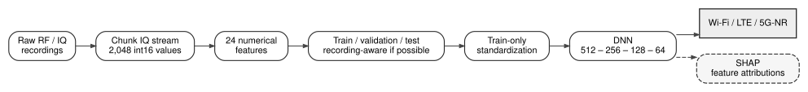
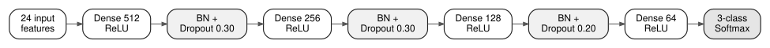

# Explainable Deep Learning for Wireless Signal Classification

**Physical-layer classification of Wi-Fi, LTE, and 5G-NR signals using IQ-derived features and SHAP**

[Research methodology](docs/METHODOLOGY.md) · [Algorithms](docs/ALGORITHMS.md) · [Data schema](docs/DATA_DICTIONARY.md) · [Reproducibility notes](docs/REPRODUCIBILITY_NOTES.md)

This repository is a **partial, documented research-code release** associated with the manuscript *Explainable Deep Learning for Physical-Layer Classification of Wi-Fi, LTE and 5G-NR Signals Using SHAP*, prepared for consideration by *Wireless Networks* (Springer Nature). It shows selected parts of the workflow and model architecture. It is **not** an archive of the complete training environment, original measurement files, pretrained model, or independently verified reproduction of the reported findings.

## Research overview

Identifying the radio technology present in an observed signal is useful for heterogeneous-spectrum monitoring. Here, a short recording of alternating in-phase (I) and quadrature (Q) samples is represented by statistical, phase, energy, spectral, and entropy descriptors. These descriptors feed a dense neural network that assigns one of three technology-family labels. A SHAP analysis is used to inspect feature contributions to the classifier's decisions.



*Monochrome workflow illustration; editable Graphviz source: [`pipeline.dot`](docs/figures/pipeline.dot).*

> **Chunk convention:** In the source notebook, a 2,048-element chunk contains **1,024 complex I/Q pairs** because the raw file is read as alternating `int16` I and Q values. This distinction matters when comparing segment lengths across publications.

## What is publicly included

| Location | Contents |
| --- | --- |
| `src/wireless_xai/features.py` | 24 signal features transcribed and cleaned from the later chunking experiment |
| `src/wireless_xai/dnn.py` | Untrained 512–256–128–64 dense-classifier blueprint with dropout and batch normalization |
| `src/wireless_xai/explain.py` | Optional small-sample SHAP reference function |
| `scripts/prepare_features.py` | Streaming extractor for locally available `.data` recordings |
| `scripts/train_public_example.py` | Optional *new* training demonstration using a separate validation set and training-only scaling |
| `docs/ALGORITHMS.md` | Algorithm pseudocode and input/output contract |
| `docs/METHODOLOGY.md` | Mathematical description and feature taxonomy |
| `docs/DATA_DICTIONARY.md` | Dataset layout and feature-column definitions |
| `docs/REPRODUCIBILITY_NOTES.md` | Known limitations, checks, and what is not released |
| `tests/` | Small synthetic unit tests; no experimental IQ recordings |

**Not included:** raw recordings, processed dataset files, full internal notebooks, trained model weights, and original SHAP output arrays. Availability should not be inferred from the presence of an empty `data/` folder. The actual data release status is described in [data/README.md](data/README.md).

## Model details

The uploaded `Explanable_AI_DNN(1).ipynb` contains 24 numeric features and class labels `0` = Wi-Fi, `1` = LTE, `2` = 5G-NR. Its recorded DNN uses the following design:



*Architecture illustration; editable Graphviz source: [`architecture.dot`](docs/figures/architecture.dot).*

The baseline reported in that notebook used the Adam optimizer, sparse categorical cross-entropy, up to 100 epochs, and batch size 256. This repository does **not** publish an independently verified recreation of that training run.

### Results in the source notebooks

| Recorded item | Value |
| --- | ---: |
| Processed rows after notebook cleaning | 292,955 |
| Numeric input features | 24 |
| Dataset class counts (Wi-Fi / LTE / 5G-NR) | 117,182 / 117,182 / 58,591 |
| Notebook test partition | 58,591 rows |
| Notebook's reported final accuracy | 91.68% |

**Interpretation caution.** The notebook fitted `StandardScaler` before the data split and monitored its test partition as training validation. Segments from the same recording could also be present on both sides of the split. Therefore **91.68% is a historical notebook-reported metric, not an independently validated generalization estimate**. Running `train_public_example.py` creates a different experiment; it should not be expected to reproduce that percentage.

## Install and inspect the public code

Python **3.10–3.12** is recommended. No dataset is included.

```bash
git clone https://github.com/shreyas250825/Explanable-AI-Research-Work.git
cd Explanable-AI-Research-Work
python -m venv .venv
# Activate the environment, then:
python -m pip install -r requirements.txt
python -m pytest -q
```

On Linux/macOS, activate with `source .venv/bin/activate`. On Windows PowerShell, use `.venv\Scripts\Activate.ps1`.

To construct the optional Keras classifier, install its extra dependencies:

```bash
python -m pip install -r requirements-ml.txt
```

**Feature extraction (requires separately obtained recordings):**

```bash
python scripts/prepare_features.py \
  --data-root /path/to/Wireless \
  --output data/processed_features.csv \
  --max-chunks-per-file 100
```

Remove `--max-chunks-per-file` when intentionally processing complete recordings. The input directory must have `Wi-Fi/<scenario>/*.data`, `LTE/<scenario>/*.data`, and `5G-NR/*.data` subpaths. Only publish any generated CSV if you have the necessary permissions and have checked its provenance.

**Optional new model demonstration (requires the processed CSV and TensorFlow):**

```bash
python scripts/train_public_example.py \
  --csv data/processed_features.csv \
  --epochs 10
```

Training output is written locally under `results/` (ignored by Git). The script uses recording-level separation when enough `source_file` identifiers exist; otherwise it warns about a weaker row-based demonstration. This is **not** a claim that the research has been revalidated.

## Code and data availability

- **Partial reference code:** this repository, https://github.com/shreyas250825/Explanable-AI-Research-Work
- **Raw IQ recordings:** not included in this distribution.
- **Processed dataset:** not included in this distribution; a future dataset release requires a separate verified deposit and clear licensing/provenance.
- **Original complete experiments:** not fully reconstructible from these public files alone.

If the processed dataset is later deposited in this repository or a release archive, replace this paragraph and the placeholders in [docs/PAPER_AVAILABILITY_STATEMENT.md](docs/PAPER_AVAILABILITY_STATEMENT.md) with the exact permanent link and version.

## Research context and attribution

**Manuscript authors:** Parthasarathy K. P.; Shreyas Salian; Om Jee Pandey; Rishabh Shukla. The fourth author's stated affiliation is Konverge AI, Nagpur, India. Authorship and the final manuscript's metadata should be confirmed by the team before publication.

**Associated journal:** [Wireless Networks — Springer Nature](https://link.springer.com/journal/11276). A manuscript submission or acceptance is **not** asserted here.

For inquiries or permissions, please open an issue or contact the corresponding author via the manuscript's official correspondence details. **No license has been selected for redistribution or derivative reuse.**
